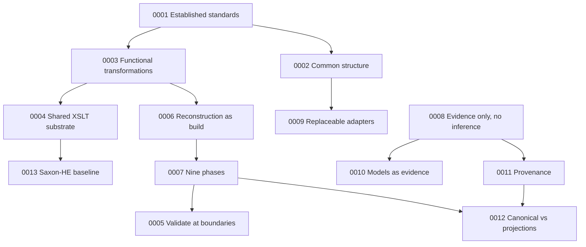

# Architecture Decision Records

## Purpose

Record the architecture decisions that shape Flowdigger, with their context, rationale, current realization and evidence.

## Audience

Architects, developers and reviewers who need to know *why* Flowdigger works the way it does.

## Nature of these records

These ADRs are a **retrospective architecture baseline**. They were reconstructed from the current implementation, the documentation on this site, and earlier internal decision records. They describe decisions that the implementation realizes today. They do not claim when or by whom each decision was first made.

- **Accepted**: the decision is realized and supported by evidence in the Flowdigger repositories.
- **Proposed**: the decision is intended, but only partly realized.
- **Superseded**: the decision is replaced by a later ADR.

Earlier internal decision records are summarized in [Historical decision records](history.md). How this set was produced is described in the [Reconstruction report](reconstruction-report.md). New ADRs use the [ADR template](template.md).

## Decision map

## Decisions

| ADR | Decision | Status |
|---|---|---|
| [0001](0001-prefer-established-standards.md) | Prefer established standards before Flowdigger-specific semantics | Accepted |
| [0002](0002-common-structural-representation.md) | Represent heterogeneous evidence in a common structure that keeps source-specific names | Accepted |
| [0003](0003-functional-transformations.md) | Use functional, declarative transformations for deterministic knowledge derivation | Accepted |
| [0004](0004-shared-xslt-substrate.md) | Share one XSLT execution substrate for transformation, validation and extraction | Accepted |
| [0005](0005-validate-at-transformation-boundaries.md) | Validate derived knowledge at meaningful transformation boundaries | Accepted |
| [0006](0006-knowledge-reconstruction-as-build.md) | Treat knowledge reconstruction as a reproducible build | Accepted |
| [0007](0007-explicit-pipeline-phases.md) | Separate the lineage lifecycle into nine single-responsibility phases | Accepted |
| [0008](0008-derive-from-evidence-without-inference.md) | Derive knowledge only from evidence, keep gaps visible, keep AI assistive | Accepted |
| [0009](0009-replaceable-source-adapters.md) | Keep source adapters replaceable and source-specific | Accepted |
| [0010](0010-architecture-models-as-evidence.md) | Use architecture models as binding evidence for intent, not as the sole source of truth | Accepted |
| [0011](0011-preserve-provenance.md) | Preserve provenance from source evidence to derived knowledge | Proposed |
| [0012](0012-separate-canonical-knowledge-from-projections.md) | Separate canonical knowledge from consumer projections | Accepted |
| [0013](0013-saxon-he-baseline.md) | Use Saxon-HE as baseline processor with an optional schema-aware path | Accepted |

## Reading order

- **New to Flowdigger:** 0008, 0010, 0007, 0012.
- **Developers:** 0003, 0004, 0005, 0006, 0009.
- **Standards and interoperability:** 0001, 0002, 0011, 0013.

## Related

- [Flowdigger deterministic knowledge derivation](../flowdigger-deterministic-knowledge-derivation.md)
- [Derivation lifecycle](../core-concepts/derivation-lifecycle.md)
- [Evidence model](../core-concepts/evidence-model.md)
- [Glossary](../reference/glossary.md)
