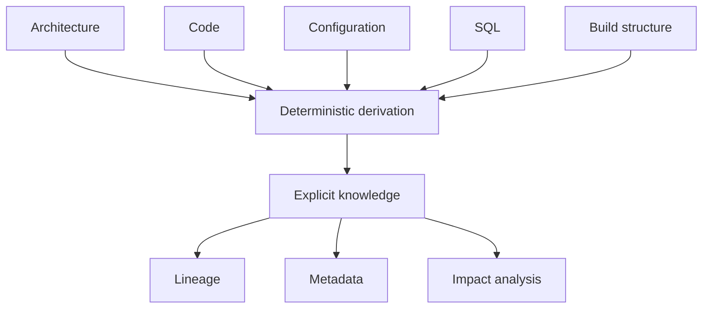
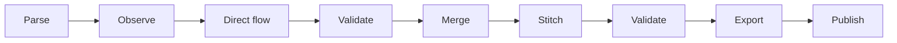
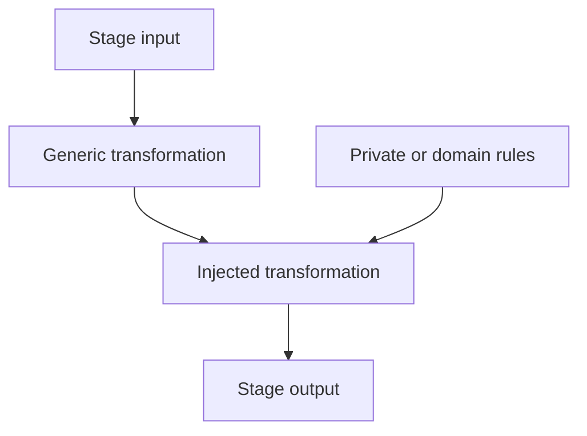
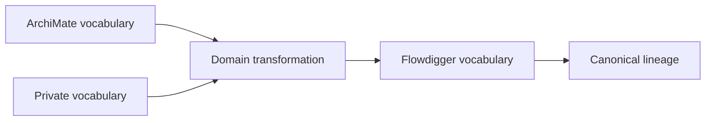
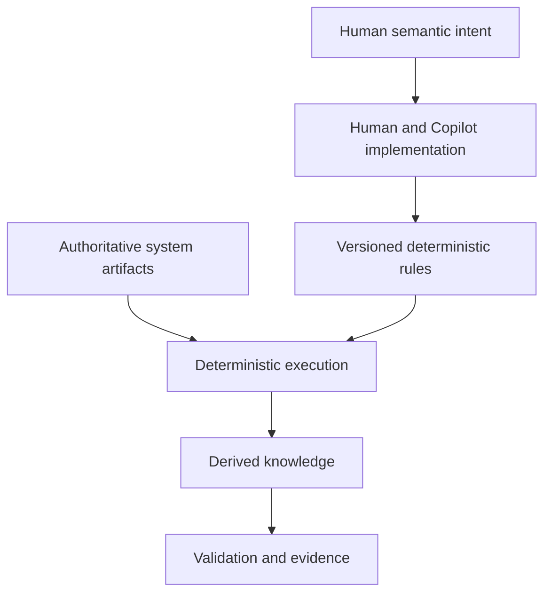

# Flowdigger: Deterministic Knowledge Derivation from Software Systems

## Abstract

Legacy software contains more knowledge than its documentation normally records. Architecture models describe intended structure, source code contains implementation structure, configuration connects components, SQL expresses data movement, and build files describe how these parts are assembled. The problem is not simply to collect this material. The problem is to derive a coherent, reproducible interpretation from it.

Flowdigger approaches this as **deterministic knowledge derivation**. Authoritative source artifacts remain the source of truth. A staged transformation pipeline parses, observes, relates, validates, merges, stitches, exports, and publishes derived knowledge. The pipeline emerged from a working lineage implementation and was separated from Application-specific knowledge so that the reusable mechanism could be open source while organization-specific interpretation remained outside it.

A particularly useful property is **transformation injection**: pipeline stages can be enriched with additional transformations. These transformations can introduce or interpret namespaced vocabularies, for example to map application-component metadata in an ArchiMate model to code, configuration, and database artifacts. AI changes the economics of this approach. Copilot can help write and maintain transformation code, while production execution remains deterministic, testable, and auditable.

This paper explains the model for managers, developers, and business analysts without requiring prior knowledge of XSLT or compiler construction.

## 1. The problem: software knowledge is distributed

A running application is rarely described completely in one place. Relevant knowledge can be distributed across:

- architecture models;
- source code;
- SQL and stored procedures;
- configuration;
- build definitions;
- deployment conventions;
- metadata and naming conventions.

A conventional metadata repository can store a description of the system, but this creates a synchronization problem. The implemented system changes, while manually maintained metadata can lag behind.

Flowdigger starts from a different principle:

> **The source system remains authoritative. Knowledge is derived from its artifacts reproducibly.**

This does not mean every fact is literally present in one file. Some useful knowledge only becomes visible when facts from multiple artifacts are combined under explicit interpretation rules.

For example, an architecture model can identify an application component, configuration can identify a database schema, Java can identify execution structure, and SQL can identify direct data movement. The relationship between all of these can be derived without asking an AI model to guess it at runtime.



## 2. From lineage implementation to reusable pipeline

The Flowdigger structure did not start as an abstract framework design. It came from a working lineage pipeline. The reusable processing machinery had to be separated from Application-specific implementation knowledge.

That extraction exposed a sequence of stable processing stages:

1. **Parse**: convert source languages into structured syntax artifacts.
2. **Observe**: identify semantic facts in source, configuration, documents, and models.
3. **Direct flow**: derive immediate source-operation-target relationships.
4. **Validate direct flow**: check those local relationships.
5. **Merge**: combine validated intermediate results.
6. **Stitch**: connect local relationships into application-level lineage.
7. **Validate lineage**: check the integrated lineage result.
8. **Export**: produce representations for downstream consumers.
9. **Publish**: package and distribute the resulting artifacts.

These stages are not arbitrary workflow boxes. They are transformation boundaries discovered by decomposing an existing implementation.



The Gradle lineage plugin acts as an **opinionated orchestrator**. Its purpose is not merely to invoke unrelated tools. It establishes the pipeline structure, connects artifacts between stages, applies defaults, and provides a coherent way to execute the total derivation.

## 3. Extraction is not enough: knowledge derivation

The term *extraction* is too narrow for the complete process.

Extraction exposes something already present:

```text
source contains fact A
        ->
extract fact A
```

Knowledge derivation combines evidence with explicit interpretation:

```text
fact A + fact B + interpretation rule R
        ->
derived fact C
```

Consider an application component in an architecture model. Its metadata can identify conventions that correspond to Java packages, configuration namespaces, directories, or database objects. Source inspection can independently establish facts about those artifacts. A deterministic mapping can then establish that these implementation artifacts belong to the modeled application component.

The resulting relation might never have existed as a single statement in the original system. It is nevertheless reproducible because the evidence and the interpretation rule are explicit.

This makes **knowledge derivation** a better description than projection. Projection usually implies selecting or reshaping information that is already explicitly represented. Flowdigger can establish higher-order knowledge from multiple observations.

## 4. Transformation injection

Separating reusable machinery from Application-specific interpretation creates an important requirement: the open pipeline must permit additional domain knowledge without embedding that knowledge in the core.

This leads to **transformation injection**.

A pipeline stage has default deterministic behavior. Additional transformations can participate at a defined stage to enrich the intermediate artifact.



The mechanism resembles dependency injection, but the injected item is different.

Conventional dependency injection supplies an implementation that provides runtime behavior:

```text
interface <- implementation
```

Transformation injection supplies deterministic interpretation:

```text
artifact <- transformation <- domain knowledge
```

This distinction matters. The extension does not have to become part of the Flowdigger codebase. A Application-specific transformation can remain private while operating at a stable public processing boundary.

## 5. Namespaces make the extension semantic

Transformation injection becomes more powerful when transformations can work with namespaced vocabularies.

Different domains can retain distinct semantic identities, for example:

```text
flow:*    generic lineage concepts
archi:*   architecture concepts
app:*     Application-specific concepts
```

The Flowdigger core does not need to understand every private concept. An injected transformation can interpret a private or external vocabulary and produce facts understood by a later stage.



For example, an organization-specific transformation can define how metadata attached to an ArchiMate Application Component identifies code locations, configuration, or database structures. That mapping is executable knowledge.

This gives a clean separation:

### Open Flowdigger

- generic pipeline structure;
- generic vocabularies;
- parsing and observation mechanisms;
- default transformations;
- validation;
- orchestration;
- export and publication.

### Private or domain-specific extensions

- organization-specific vocabularies;
- architecture conventions;
- naming conventions;
- component-to-code mappings;
- interpretation transformations;
- additional validation rules.

This boundary is more useful than trying to make the generic model understand every application's conventions.

## 6. XSLT as executable interpretation

The implementation makes extensive use of XSLT. That choice can appear unusual to developers accustomed to Java, Kotlin, Python, or JavaScript extension APIs.

The relevant property is not XML syntax itself. It is the transformation model:

- structured input;
- explicit vocabularies;
- namespace-aware processing;
- deterministic transformations;
- composition of stages;
- side-effect-free processing;
- output that can immediately become input to another transformation.

XSLT therefore acts as **executable interpretation**. It states how evidence expressed in one or more vocabularies becomes new explicit knowledge.

There is a homoiconic quality to the mechanics, although it is not strict Lisp-style homoiconicity. Data, transformation programs, validation rules, and generated artifacts can all use a common structured XML substrate. Transformations can themselves be generated, inspected, tested, versioned, and transformed.

The practical consequence is more important than the terminology: the system can treat interpretation as an explicit artifact rather than hiding it in application code.

## 7. The role of the Gradle DSL

The Gradle DSL provides the opinionated structure around these transformations. It can describe source sets, repositories, models, pipeline configuration, and eventually the transformations that participate in particular stages.

The key separation is:

```text
Gradle DSL        -> composition and structure
XSLT              -> interpretation and transformation
XIR/artifacts     -> explicit intermediate knowledge
Schematron/tests  -> assertions and verification
Gradle tasks      -> deterministic orchestration
```

The DSL should not become another transformation language. Its role is to describe **what participates where**.

This is valuable for normal application developers because they should not need to understand the full transformation machinery. A developer can configure and run the pipeline. A metadata or lineage engineer can inspect the generated stages. An extension author can work with the deeper vocabulary and transformation model.

## 8. AI changes the economics, not the authority

Historically, one cost of XSLT-based systems was specialist knowledge. The transformation model is powerful, but many developers are less familiar with XSLT, XPath, XDM, and XML namespaces than with mainstream imperative languages.

AI assistance changes this constraint.

The human can define:

- semantic intent;
- vocabulary boundaries;
- expected mappings;
- invariants;
- examples;
- tests.

Copilot can assist with:

- implementing XSLT;
- writing XPath expressions;
- generating repetitive mappings;
- refactoring transformations;
- writing validation and tests;
- explaining existing transformation code.

The critical architectural point is that AI does not have to be part of production knowledge derivation.



This preserves a useful boundary:

> **AI helps construct the specification; deterministic software executes it.**

For audit-sensitive lineage and metadata, this is materially different from asking an AI model to inspect the system repeatedly and generate an answer on demand. The same source artifacts and the same versioned rules can produce the same result again.

## 9. What this means for different audiences

### For managers

Flowdigger reduces the need to maintain a second manual description of a changing software system. Investment goes into repeatable derivation rules rather than repeated metadata reconstruction.

The model also separates reusable engineering from organization-specific intellectual property. Generic processing can be open source while private interpretation stays private.

AI can reduce implementation effort without becoming the authority for produced lineage. This distinction is important where explainability, reproducibility, and control matter.

### For developers

Flowdigger treats lineage as a build product. The normal development toolchain can produce knowledge artifacts in the same way it produces binaries, generated sources, reports, or documentation.

Most developers need to understand only the configuration and outputs. Developers implementing extensions need the deeper transformation model.

This avoids forcing every application to implement a bespoke lineage API while still allowing application-specific semantics where they are necessary.

### For business analysts and metadata specialists

Architecture and metadata conventions can become executable instead of remaining prose instructions.

A mapping such as "this ArchiMate metadata identifies the implementation boundary of this application component" can be encoded once, tested, and applied consistently whenever the source changes.

This tightens the relationship between architecture, implementation, metadata, and lineage without asserting that any one repository contains the whole truth.

## 10. A layered trust model

The approach implies a useful trust hierarchy:

1. **Authoritative artifacts** provide evidence.
2. **Explicit deterministic rules** interpret that evidence.
3. **Intermediate artifacts** make derivation inspectable.
4. **Validation** checks required properties.
5. **Published lineage and metadata** are reproducible outputs.
6. **AI assistance** can improve the rules but is outside the runtime evidence chain.

This structure is particularly suitable where generated metadata must be explainable. A lineage relation can be traced to source observations and the transformation rules that established it.

The result is not "true because Flowdigger says so." It is true under identifiable source evidence and explicit interpretation rules.

## 11. Design consequences

Several practical principles follow from the architecture.

### Keep source artifacts authoritative

Do not turn intermediate metadata into an independent source of truth unless there is a specific governance reason to do so. Regenerate derived knowledge when authoritative inputs change.

### Keep transformation boundaries explicit

The identified stages provide useful contracts for testing, inspection, and extension. Avoid hiding several semantic operations inside one opaque processor.

### Keep domain interpretation outside the generic core

Do not grow the Flowdigger vocabulary whenever one application needs a new convention. Use namespaced vocabularies and transformations to translate domain knowledge into generic lineage concepts where appropriate.

### Prefer small transformation injection over a large extension framework

The current need is to attach additional deterministic interpretation to existing stages. XSLT already supplies the transformation language. The Gradle DSL only needs enough structure to compose those transformations clearly.

### Make generated knowledge reviewable

AI-generated transformation code must remain ordinary version-controlled code with tests and deterministic execution. AI generation does not remove the need for reviewable semantics.

## 12. Broader interpretation

Flowdigger started from lineage, but the pattern is broader.

A software system contains latent knowledge in its structure. When that knowledge can be observed and interpreted through explicit rules, the same machinery can support:

- lineage;
- impact analysis;
- architecture conformance;
- metadata production;
- dependency analysis;
- application-component mapping;
- comparison between environments or versions;
- evidence for modernization and migration work.

This suggests three useful terms with distinct meanings:

**Knowledge archaeology** is the activity of discovering the knowledge embedded in existing systems.

**Knowledge derivation** is the deterministic mechanism that turns evidence and interpretation rules into explicit knowledge.

**Flowdigger** is machinery for making that process executable, reproducible, and composable.

## Conclusion

Flowdigger is best understood not as a metadata repository and not merely as a collection of Gradle plugins. It is an **opinionated deterministic knowledge-derivation pipeline for software systems**.

Its processing stages emerged from a working lineage implementation. Separating that machinery from Application-specific knowledge exposed a useful architectural boundary: generic processing can remain open, while domain-specific interpretation can be injected as transformations.

Namespaces make those transformations more than procedural hooks. They allow independent vocabularies to coexist and allow explicit rules to translate between architecture, code, configuration, database, and lineage concepts.

AI then occupies a controlled role. Copilot can work with humans to create, explain, and maintain the transformations, while the resulting knowledge is still produced by deterministic software from authoritative artifacts.

The resulting model is deliberately asymmetric:

```text
Humans + AI design the interpretation.
Deterministic software executes the interpretation.
Source artifacts remain the evidence.
Derived knowledge remains reproducible.
```

That separation is the central property of the ecosystem. It makes sophisticated interpretation compatible with automation without making probabilistic AI the operational source of truth.
