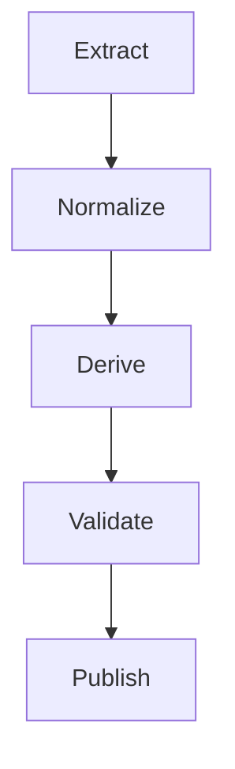

# Derivation Lifecycle

## Purpose

Describe the conceptual lifecycle for lineage derivation. For components and implementation status, see the [architecture map](../lineage/index.md).

## Steps

1. **Extract** evidence from code, SQL, configuration, and metadata.
2. **Normalize** evidence into common intermediate representation.
3. **Derive** lineage facts with deterministic rules.
4. **Validate** facts with quality checks.
5. **Publish** lineage views for users and governance tools.

## Lifecycle diagram

## Mapping to pipeline phases

The five steps are a simplified view. The [Gradle Lineage Plugin](https://github.com/flowdigger/gradle-lineage-plugin) implements them as nine phases ([ADR-0007](../adr/0007-explicit-pipeline-phases.md)):

| Lifecycle step | Pipeline phases |
|---|---|
| Extract | 1 parse |
| Normalize | 2 observe |
| Derive | 3 direct flow, 5 merge, 6 stitch |
| Validate | 4 validate direct flow, 7 validate lineage |
| Publish | 8 export, 9 publish |

Merge combines results of the same kind and adds no new relations. Stitch adds relations across components, only from explicit declarations.

## Output

The lifecycle is a model of repeatable production, not a fully runnable example. See [implementation status](../lineage/index.md#implementation-status).

## Related

- [ADR-0003: Functional transformations](../adr/0003-functional-transformations.md)
- [ADR-0007: Nine pipeline phases](../adr/0007-explicit-pipeline-phases.md)

- [Build first lineage slice](../how-to/build-first-lineage-slice.md)
- [Validate lineage quality](../how-to/validate-lineage-quality.md)
- [Extract, Derive, Resolve, Publish paper](../Extract-Derive-Resolve-Publish-Paper.md)

