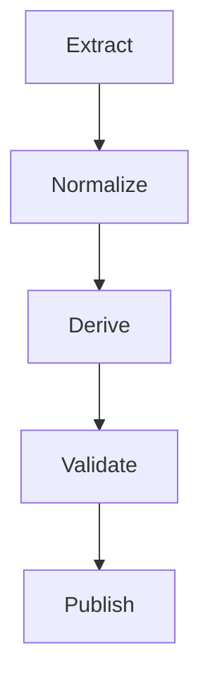

# Derivation Lifecycle

## Purpose

Describe standard lifecycle for lineage derivation.

## Steps

1. **Extract** evidence from code, SQL, configuration, and metadata.
2. **Normalize** evidence into common intermediate representation.
3. **Derive** lineage facts with deterministic rules.
4. **Validate** facts with quality checks.
5. **Publish** lineage views for users and governance tools.

## Lifecycle diagram

## Output

You get repeatable lineage production process.

## Related

- [Build first lineage slice](../how-to/build-first-lineage-slice.md)
- [Validate lineage quality](../how-to/validate-lineage-quality.md)
- [Extract, Derive, Resolve, Publish paper](../Extract-Derive-Resolve-Publish-Paper.md)

