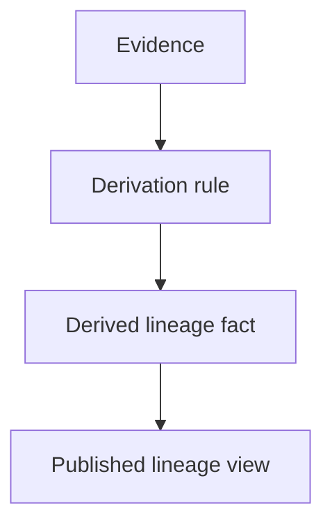

# Evidence Model

## Purpose

Explain how evidence supports trustworthy lineage.

## Audience

Developers and analysts. Managers can use summary section.

## Evidence classes

- **Structural evidence**: schema, table definitions, file structures.
- **Behavioral evidence**: code paths, transformation logic, workflow steps.
- **Operational evidence**: runtime logs, job metadata, deployment metadata.

## Rules

1. Keep source evidence immutable.
2. Keep derivation functions deterministic.
3. Aim to keep provenance links from derived facts to source evidence.
4. Keep confidence level explicit.
5. Keep gaps visible. Do not fill missing relations with guesses.

Design decisions behind these rules: [ADR-0008](../adr/0008-derive-from-evidence-without-inference.md), [ADR-0010](../adr/0010-architecture-models-as-evidence.md), [ADR-0011](../adr/0011-preserve-provenance.md).

## Compact model

## Output

These are design goals, not guarantees for every result. Provenance is carried through merge but is incomplete after stitch; end-to-end provenance and PROV-O mapping are not implemented. See [ADR-0011](../adr/0011-preserve-provenance.md) and [technical evidence](../learn/system-knowledge/technical-evidence.md).

