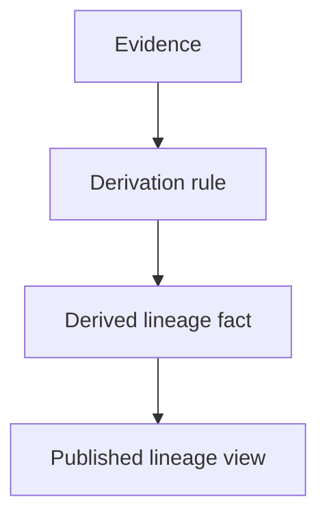

# Evidence Model

## Purpose

Explain how evidence supports trustworthy lineage.

## Audience

Developers and analysts. Managers can use summary section.

## Evidence classes

- **Structural evidence**: schema, table definitions, file structures.
- **Behavioral evidence**: code paths, transformation logic, workflow steps.
- **Operational evidence**: runtime logs, job metadata, deployment metadata.

## Rules

1. Keep source evidence immutable.
2. Keep derivation functions deterministic.
3. Keep provenance link from derived fact to source evidence.
4. Keep confidence level explicit.

## Compact model

## Output

You can explain why lineage fact exists and where it comes from.

