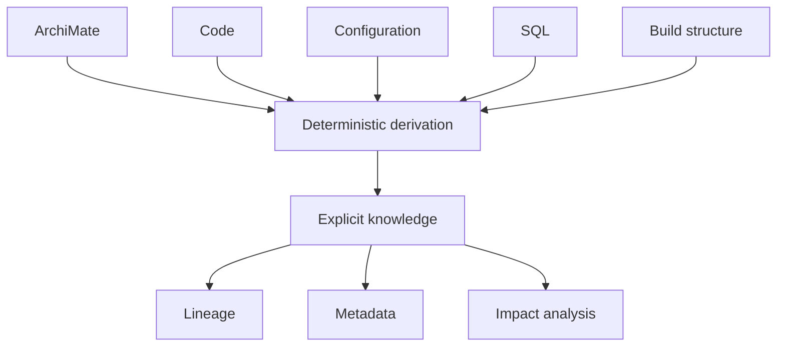
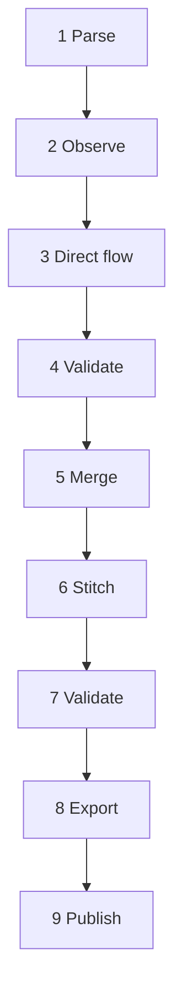
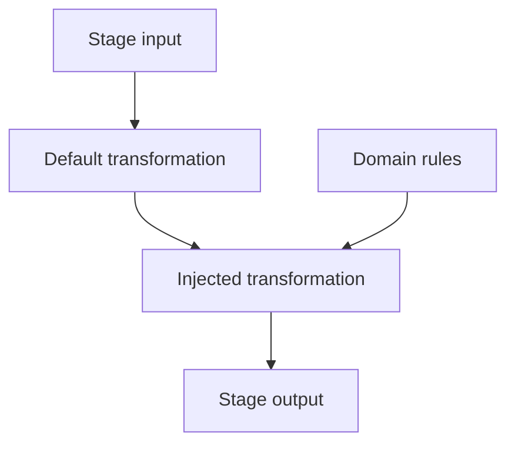
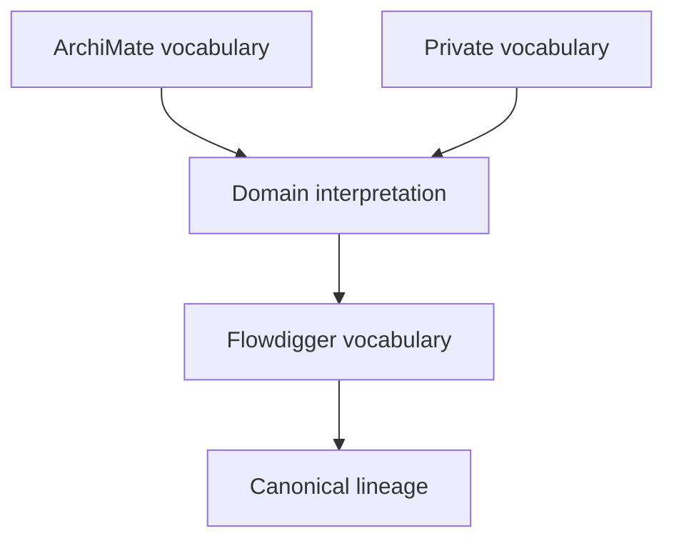
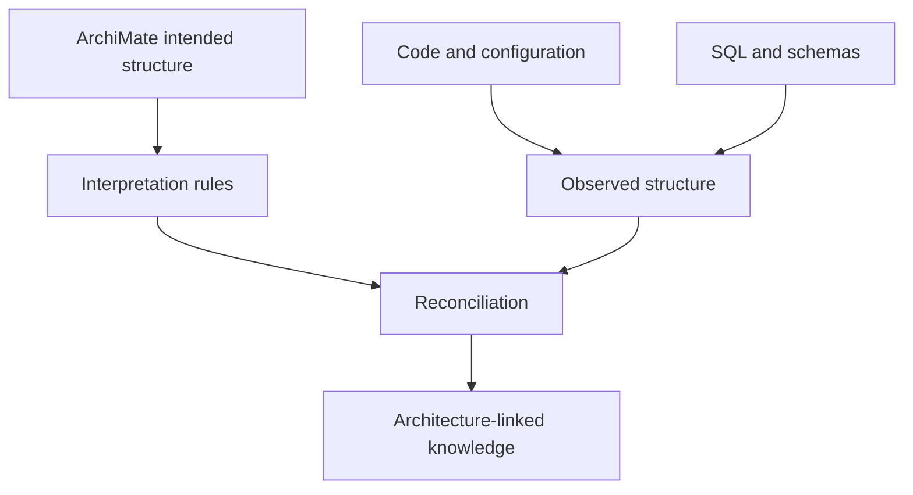
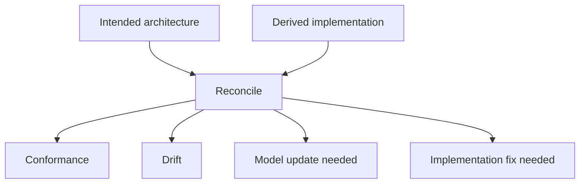
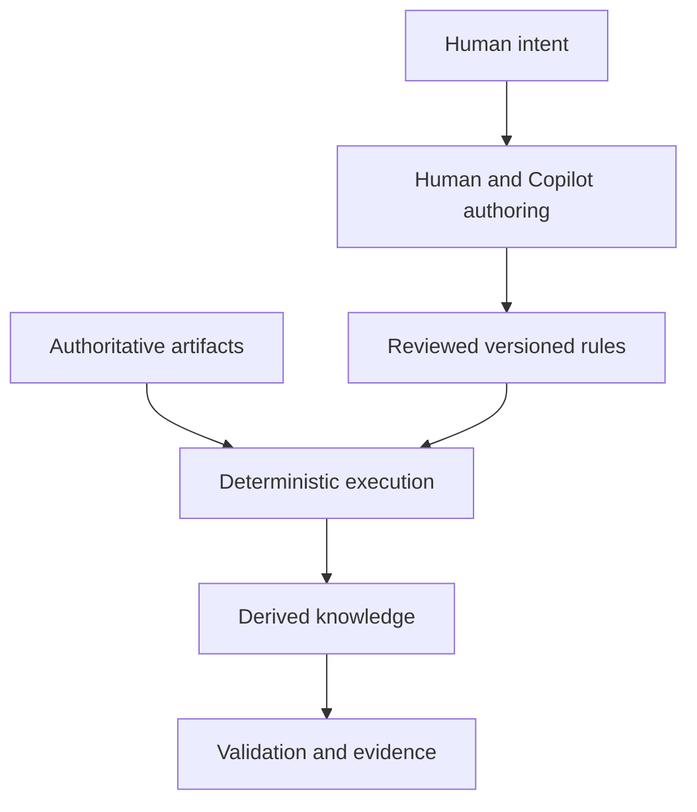

# Flowdigger: Deterministic Knowledge Derivation, Transformation Injection, and Continuous Architecture Reconciliation

## Abstract

Legacy software contains more knowledge than its documentation normally records. Architecture models describe intended structure, source code contains implementation structure, configuration connects components, SQL expresses data movement, and build files describe how these parts are assembled. The problem is not only to collect this material. The problem is to derive a coherent, traceable, and reproducible interpretation from it.

[Flowdigger](https://flowdigger.github.io/) approaches this as **deterministic knowledge derivation**. Authoritative source artifacts remain the evidence. A staged pipeline parses, observes, relates, validates, merges, stitches, exports, and publishes derived knowledge. The pipeline originated in a working lineage implementation and was separated from Application-specific knowledge so that reusable machinery could become open source while organization-specific interpretation remained private.

A central mechanism is **transformation injection**. Pipeline stages have default behavior, but additional transformations can enrich them with domain-specific interpretation. These transformations can introduce and interpret namespaced vocabularies, for example to map metadata on [ArchiMate](https://www.opengroup.org/archimate-forum/archimate-overview) Application Components to source code, configuration, and database artifacts.

The approach also supports **Continuous Architecture Reconciliation**. ArchiMate supplies the architectural bootstrap: an explicit statement of intended structure. Flowdigger derives realized structure from implementation evidence and reconciles the two. The same mechanism can be applied to Flowdigger itself, making the ecosystem reflectively self-describing.

AI changes the economics of the approach. A human and Copilot can create transformations, validations, and tests together, while the production result remains deterministic, versioned, reviewable, and reproducible. AI assists in constructing the interpretation but does not become the operational source of truth.

## 1. Software knowledge is distributed

A running application is rarely described completely in one place. Relevant knowledge can be distributed across:

- [ArchiMate](https://www.opengroup.org/archimate-forum/archimate-overview) architecture models;
- Java, SQL, PL/SQL, and other source languages;
- application and deployment configuration;
- stored procedures and database schemas;
- build definitions and dependency graphs;
- documents and spreadsheets;
- naming, packaging, and ownership conventions.

A metadata repository can store a description of the system, but a manually maintained description creates a synchronization problem. The implementation changes while the description can lag behind.

Flowdigger starts from a different principle:

> **The implemented system remains authoritative evidence. Knowledge is derived from its artifacts through explicit, versioned rules.**

This does not mean that every useful fact exists literally in one source file. Some knowledge only becomes visible when observations from different artifacts are combined under explicit interpretation rules.



For example, an architecture model can identify an Application Component, configuration can identify a database schema, Java can identify execution structure, and SQL can identify data movement. Flowdigger can derive the relationship between them without asking an AI model to infer it whenever the pipeline runs.

## 2. From a working lineage pipeline to reusable machinery

Flowdigger did not start as an abstract framework design. It came from a working lineage pipeline. The practical requirement was to remove reusable implementation machinery from Application without open-sourcing Application-specific knowledge.

That extraction exposed nine stable processing phases:

1. **Parse** converts source languages into structured syntax artifacts.
2. **Observe** extracts semantic facts from source, configuration, documents, and models.
3. **Direct flow** derives immediate source-operation-target relationships.
4. **Validate direct flow** checks the local flow contracts.
5. **Merge** combines validated intermediate results and prepares indexes.
6. **Stitch** connects local relationships into canonical application lineage.
7. **Validate lineage** checks the integrated result.
8. **Export** creates representations for downstream consumers.
9. **Publish** packages and distributes the resulting artifacts.

These are not arbitrary workflow boxes. They are transformation boundaries discovered by decomposing a real implementation.



The [Gradle Lineage Plugin](https://github.com/flowdigger/gradle-lineage-plugin) is the opinionated orchestrator for this lifecycle. Its published contract is:

```text
SOURCE -> SYNTAX -> SEMANTICS -> FLOW -> LINEAGE
```

It connects stage inputs and outputs, applies conventions, wires task dependencies, invokes specialized capabilities, and publishes the final artifacts. It is not the only source of semantics. It provides the structure within which deterministic interpretation occurs.

## 3. Extraction, observation, and knowledge derivation

The term **extraction** is too narrow for the complete process.

Extraction exposes something already present:

```text
source contains fact A
        ->
extract fact A
```

Observation gives a source fact an explicit structured form:

```text
source construct A
        ->
observation vocabulary describes A
```

Knowledge derivation combines evidence with interpretation:

```text
observation A + observation B + rule R
        ->
derived fact C
```

Consider metadata on an ArchiMate Application Component. The metadata can encode conventions corresponding to Java packages, configuration namespaces, directories, or database objects. Source inspection can independently establish facts about those artifacts. A deterministic mapping can then establish that the artifacts realize or participate in the modeled component.

The resulting relation might never have existed as one statement in the legacy system. It is nevertheless reproducible because its evidence and interpretation rule are explicit.

This is why **knowledge derivation** is more precise than **projection**. Projection commonly means selecting or reshaping information already represented. Flowdigger can establish higher-order knowledge by combining multiple observations.

## 4. Transformation injection

Separating reusable machinery from Application-specific interpretation creates a requirement: the public pipeline must permit additional domain knowledge without embedding that knowledge in its core.

This leads to **transformation injection**.

A pipeline stage has default deterministic behavior. Additional transformations can run at that stage and enrich the intermediate artifact.



The idea resembles [dependency injection](https://martinfowler.com/articles/injection.html), but the injected item is different.

Conventional dependency injection supplies an implementation that provides runtime behavior:

```text
interface <- implementation
```

Transformation injection supplies explicit interpretation:

```text
artifact <- transformation <- domain knowledge
```

A private Application transformation can therefore participate at a stable public Flowdigger stage without becoming part of the open-source implementation.

The mechanism can support several composition semantics if they become necessary:

- **before** prepares or normalizes the stage input;
- **enrich** adds knowledge to the default result;
- **after** derives a downstream representation;
- **validate** asserts required properties;
- **replace** substitutes default behavior where explicitly allowed.

The design does not require a new transformation language. [XSLT](https://www.w3.org/TR/xslt-30/) already provides that language. The Gradle DSL only needs to state which transformations participate, at which stage, and in which order.

## 5. Namespaces allow vocabulary injection

Transformation injection becomes more significant when injected transformations introduce or interpret [XML namespaces](https://www.w3.org/TR/xml-names/). A namespace identifies a vocabulary. It permits concepts from different domains to coexist without forcing all concepts into one canonical schema.

For example:

```text
flow:*    generic lineage concepts
archi:*   architecture concepts
app:*     application-specific concepts
```

The Flowdigger core does not need to understand every private concept. A domain transformation can understand the external or private vocabulary and produce facts in the vocabulary expected by a later stage.



An organization-specific transformation can define how metadata attached to an ArchiMate Application Component identifies code locations, configuration, or database structures. The transformation converts a convention into executable knowledge.

This yields a clean boundary.

### Open Flowdigger

- generic pipeline structure;
- generic vocabularies;
- parsing and observation mechanisms;
- default transformations;
- validation and testing;
- orchestration;
- export and publication.

### Private or domain-specific extensions

- organization-specific vocabularies;
- architecture conventions;
- naming conventions;
- component-to-code mappings;
- interpretation transformations;
- additional validation rules.

The injection unit can eventually be treated as a semantic module containing:

- one or more vocabularies;
- transformations;
- validation rules;
- tests;
- declared input and output contracts.

## 6. XSLT as executable interpretation

The Flowdigger ecosystem makes extensive use of [XSLT 3.0](https://www.w3.org/TR/xslt-30/), [XPath 3.1](https://www.w3.org/TR/xpath-31/), the [XDM data model](https://www.w3.org/TR/xpath-datamodel-31/), and [Schematron](https://schematron.com/). These technologies can appear unfamiliar to developers accustomed to Java, Kotlin, Python, or JavaScript extension APIs.

The important property is not XML syntax. It is the processing model:

- structured and namespace-aware input;
- explicit vocabularies;
- deterministic transformations;
- composition of small stages;
- side-effect-free derivation where practical;
- output that becomes input to another transformation;
- validations that can be executed and reported.

XSLT acts as **executable interpretation**. It states how evidence expressed in one or more vocabularies becomes new explicit knowledge.

The [Gradle XML Plugin](https://github.com/flowdigger/gradle-xml-plugin) operationalizes this processing model in Gradle. It provides build tasks for XSLT, XQuery, XSD validation, Schematron, XSpec, and XIR-aware processing.

There is a homoiconic quality to the mechanics, although this is not strict Lisp-style [homoiconicity](https://en.wikipedia.org/wiki/Homoiconicity). Data, transformation programs, validation rules, and generated artifacts can share a structured XML substrate. Transformations can themselves be generated, inspected, versioned, tested, and transformed.

The practical consequence is more important than the label: interpretation becomes an explicit artifact instead of hidden behavior inside an application service.

## 7. The role of XIR

[XIR](https://github.com/jurgenei/jurgenei/blob/main/xir-starter-kit/README.md) provides a compact S-expression representation compatible with the XML information model. It reduces serialization noise while preserving namespaces, element structure, attributes, and deterministic processing.

Within Flowdigger, XIR can serve as an intermediate knowledge representation:

```text
source
  -> structured syntax
  -> observations
  -> derived flow
  -> stitched lineage
  -> projections
```

The value is not that every consumer must adopt XIR. The value is that transformations can operate over an explicit, compact, structured substrate while representations for GraphML, RDF, JSON, or application-specific consumers can be exported later.

Related repositories include:

- [xir-sax](https://github.com/flowdigger/xir-sax), a SAX reader, parser, and serializer for XIR;
- [xir-g4](https://github.com/flowdigger/xir-g4), which works with ANTLR grammar structure and schema derivation;
- [gradle-xml-plugin](https://github.com/flowdigger/gradle-xml-plugin), which executes transformations and validations over XML, XIR, and related structured content.

## 8. The Gradle DSL provides composition, not semantics

The Gradle DSL expresses the opinionated structure around the transformation pipeline. It can describe repositories, source sets, architecture models, parser selection, pipeline configuration, and injected transformations.

The responsibilities remain separate:

```text
Gradle DSL        -> composition and structure
XSLT              -> interpretation and transformation
XIR/XML artifacts -> explicit intermediate knowledge
Schematron/XSpec  -> assertions and tests
Gradle tasks      -> deterministic orchestration
```

This separation supports three audiences:

1. **Application developers** configure and run Flowdigger.
2. **Lineage and metadata engineers** inspect stages, artifacts, and traceability.
3. **Extension authors** define domain vocabularies and transformation modules.

Most users should not need to understand transformation injection. They should configure the pipeline and consume its results. The deeper model is necessary only when adding organization-specific interpretation.

## 9. ArchiMate as the architectural bootstrap

A self-describing system still requires initial semantics. In this architecture, the bootstrap is deliberate: [ArchiMate](https://www.opengroup.org/archimate-forum/archimate-overview) provides the architectural coordinate system.

The ArchiMate model states intended structure, including relevant components, interfaces, services, relationships, and metadata. Flowdigger then derives realized structure from implementation artifacts and maps the evidence back to that architectural model.



ArchiMate is therefore not merely another file to parse. It supplies initial architectural meaning. Application-specific transformation modules explain how those architectural concepts correspond to implementation conventions.

This produces a useful distinction:

- **intended architecture** is asserted in ArchiMate;
- **realized architecture** is derived from implementation evidence;
- **reconciliation** compares and connects the two.

## 10. Continuous Architecture Reconciliation

[Continuous Architecture Reconciliation](https://flowdigger.github.io/continuous-architecture-reconcilliation/) is the higher-level practice enabled by the derivation pipeline.

The objective is not to declare either the architecture model or the implementation absolutely primary. They are different observations with different responsibilities:

- architecture expresses intent, boundaries, and rationale;
- implementation provides evidence of realized structure and behavior;
- transformations express the mapping between the two;
- reconciliation exposes agreement, drift, missing mappings, and outdated assumptions.



The process can run as part of the build or delivery lifecycle. Architecture conformance then becomes executable instead of depending only on periodic manual review.

This is not one-way enforcement. A difference can mean:

- the implementation violated an intended boundary;
- the architecture model is stale;
- an interpretation rule is incomplete;
- a new domain concept must be modeled;
- the implementation uses a convention not yet made explicit.

## 11. Reflective self-description

Flowdigger can apply its own derivation machinery to itself:

```text
Flowdigger ArchiMate model
+ Gradle source and configuration
+ plugin registrations
+ XSLT and Schematron
+ namespaces and vocabularies
        ->
Flowdigger pipeline
        ->
knowledge about Flowdigger
```

This is **reflective knowledge derivation**. Flowdigger can derive an explicit model of:

- its plugins and modules;
- its pipeline phases;
- which transformations run at each phase;
- which vocabularies they consume and produce;
- how artifacts depend on each other;
- where transformations are injected;
- which validation rules constrain the stages;
- how published results trace back to sources and rules.

The result is not absolute self-description. The semantics of Gradle, XSLT, namespaces, and ArchiMate still come from standards and implementations outside the model. The designed ArchiMate bootstrap establishes the initial system semantics.

Within that boundary, Flowdigger can describe its own realized implementation and reconcile it with its intended architecture.

## 12. Dogfooding as an architecture test

Using Flowdigger to describe Flowdigger is a form of [dogfooding](https://en.wikipedia.org/wiki/Eating_your_own_dog_food). In this case, dogfooding is more than internal product use. It is an architecture test.

Self-application tests whether Flowdigger can represent:

- Gradle plugin composition;
- parsers and language-specific plugins;
- XSLT and validation assets;
- transformation injection;
- namespace and vocabulary dependencies;
- build and publication structure;
- traceability to the ArchiMate model.

However, self-description alone is insufficient because it can bias the design toward Flowdigger-shaped systems. Independent examples remain necessary. A Java and Oracle PL/SQL application exercises external applicability, while Flowdigger self-description exercises completeness and internal consistency.

```text
Flowdigger -> Flowdigger
    tests reflective completeness

Flowdigger -> independent legacy application
    tests general applicability
```

## 13. AI changes the economics, not the authority

Historically, one cost of an XSLT-based system was specialist knowledge. Many developers are less familiar with XSLT, XPath, XDM, Schematron, and namespaces than with mainstream imperative languages.

AI assistance changes this constraint.

The human supplies:

- semantic intent;
- vocabulary boundaries;
- expected mappings;
- invariants;
- representative examples;
- acceptance criteria.

Copilot can assist with:

- implementing XSLT and XPath;
- generating repetitive mappings;
- writing Schematron constraints;
- creating XSpec and integration tests;
- refactoring transformations;
- explaining existing transformation code;
- producing documentation from explicit artifacts.

The production trust boundary remains deterministic:



> **Humans and AI design the interpretation. Deterministic software executes it.**

This differs materially from using an LLM to inspect a system and generate lineage on demand. The same source artifacts and the same approved rules can produce the same result again.

## 14. Responsible and controlled AI use

This architecture is a responsible pattern for AI-assisted engineering when AI-generated changes receive the same controls as human-written code.

The relevant controls are:

- **Reviewability:** generated XSLT, mappings, and validations are inspectable source code.
- **Versioning:** Git records exactly when interpretation logic changes.
- **Testing:** transformations have representative input-output tests and assertions.
- **Reproducibility:** identical inputs and rule versions produce identical outputs.
- **Traceability:** derived knowledge can identify source evidence and the responsible transformation.
- **Rollback:** an incorrect AI-assisted change can be reverted as a software version.
- **Runtime isolation:** production derivation does not depend on model availability, prompt wording, temperature, or model-version changes.
- **Accountability:** humans approve the semantics and remain responsible for false or incomplete mappings.

Determinism does not make an incorrect rule correct. It makes the error stable, testable, explainable, and repairable. The quality of tests and review therefore remains part of the trust model.

## 15. A layered trust model

The complete approach implies a trust hierarchy:

1. **Architecture intent** is stated through ArchiMate and its metadata.
2. **Authoritative artifacts** provide implementation evidence.
3. **Explicit deterministic rules** interpret that evidence.
4. **Intermediate artifacts** make derivation inspectable.
5. **Validation** checks required properties.
6. **Reconciliation** compares intended and realized structure.
7. **Published lineage and metadata** are reproducible outputs.
8. **AI assistance** improves the rules but remains outside the runtime evidence chain.

The result is not true because Flowdigger or Copilot says so. It is supported under identifiable evidence, explicit interpretations, and executable validations.

## 16. What this means for different audiences

### Managers

Flowdigger reduces dependence on a second manually maintained description of a changing system. Investment moves toward reusable derivation rules and automated reconciliation.

The architecture separates reusable engineering from organization-specific intellectual property. Generic processing can be open source while private interpretation remains private.

AI can reduce implementation effort while staying outside the operational evidence chain. This matters where auditability, repeatability, and control are required.

### Developers

Flowdigger treats lineage and architecture-linked metadata as build products. The toolchain can generate knowledge artifacts in the same way it generates binaries, reports, tests, and documentation.

Most developers need to understand configuration and outputs. Extension authors need the deeper transformation and vocabulary model.

### Business analysts and metadata specialists

Architecture and metadata conventions become executable rather than remaining prose instructions.

A rule such as "this ArchiMate property identifies the implementation boundary of this Application Component" can be encoded once, tested, and applied consistently whenever the source changes.

The resulting knowledge remains connected to both business or architecture terminology and implementation evidence.

### Architects

The process supplies a continuous comparison between intended and realized architecture. Differences become inspectable findings rather than arguments based on incomplete diagrams or code samples.

### AI governance and assurance specialists

The pattern provides a concrete division between probabilistic assistance and deterministic operational control. AI contributes at design time, while approved software remains the execution authority.

## 17. Flowdigger ecosystem components

The open-source ecosystem separates orchestration, parsing, transformation, document handling, and domain-specific grammar support.

### Core orchestration and transformation

- [gradle-lineage-plugin](https://github.com/flowdigger/gradle-lineage-plugin): opinionated orchestration of the nine-phase lineage pipeline.
- [gradle-xml-plugin](https://github.com/flowdigger/gradle-xml-plugin): XSLT, XQuery, XSD, Schematron, XSpec, and XIR-aware processing in Gradle.
- [gradle-archi-plugin](https://github.com/flowdigger/gradle-archi-plugin): headless Archi execution and export of ArchiMate artifacts in automated builds.

### Parsing and observation

- [gradle-antlr-plugin](https://github.com/flowdigger/gradle-antlr-plugin): pluggable ANTLR parsing into XML or XIR syntax artifacts.
- [gradle-antlr-java-plugin](https://github.com/flowdigger/gradle-antlr-java-plugin): Java language parsing support.
- [gradle-antlr-plsql-plugin](https://github.com/flowdigger/gradle-antlr-plsql-plugin): Oracle PL/SQL parsing support.
- [gradle-antlr-tsql-plugin](https://github.com/flowdigger/gradle-antlr-tsql-plugin): Microsoft Transact-SQL parsing support.
- [gradle-antlr-sas-plugin](https://github.com/flowdigger/gradle-antlr-sas-plugin): SAS language parsing support.
- [gradle-ooxml-plugin](https://github.com/flowdigger/gradle-ooxml-plugin): conversion of DOCX, PPTX, and XLSX content into simplified structured representations.

### Supporting execution and representation

- [gradle-python-plugin](https://github.com/flowdigger/gradle-python-plugin): controlled Python execution in Gradle tasks with virtual-environment support.
- [xir-sax](https://github.com/flowdigger/xir-sax): parsing and serialization support for XIR.
- [xir-g4](https://github.com/flowdigger/xir-g4): structured processing of ANTLR grammar definitions.
- [Flowdigger organization on GitHub](https://github.com/flowdigger/): current repository inventory.

## 18. Design principles

The combined findings lead to several design principles.

### Keep authoritative artifacts authoritative

Regenerate derived knowledge when source artifacts or approved interpretation rules change. Do not silently turn intermediate metadata into an independent authority.

### Keep transformation boundaries explicit

The nine stages provide contracts for testing, inspection, caching, extension, and provenance. Avoid opaque processors that combine unrelated semantic operations.

### Keep domain interpretation outside the generic core

Do not expand the generic vocabulary for every application convention. Use namespaced vocabularies and domain transformations.

### Keep the DSL focused on composition

The Gradle DSL should express sources, stages, transformation modules, order, and outputs. XSLT remains the language for interpretation.

### Make provenance a first-class output

A derived relation should identify the source observations, transformations, and validation path that established it.

### Use self-description as a test, not as the only use case

Flowdigger should reconcile itself, but independent legacy-system examples must test generality.

### Keep AI outside the runtime authority boundary

Use AI to create deterministic infrastructure and interpretation rules. Do not make probabilistic answers the authoritative lineage record.

## 19. Broader interpretation

Flowdigger started from lineage, but the pattern is broader. A software system contains latent knowledge in its structure. When that knowledge can be observed and interpreted through explicit rules, the same machinery can support:

- data and control-flow lineage;
- impact analysis;
- architecture conformance;
- metadata production;
- dependency analysis;
- application-component mapping;
- comparison between environments or versions;
- migration and modernization evidence;
- generated documentation;
- self-description of the derivation system itself.

Three terms have distinct roles:

**Knowledge archaeology** is the activity of discovering knowledge embedded in existing systems.

**Knowledge derivation** is the deterministic mechanism that turns evidence and interpretation rules into explicit knowledge.

**Continuous Architecture Reconciliation** is the practice of repeatedly comparing intended architecture with the structure derived from implementation.

**Flowdigger** is the machinery that makes these activities executable, reproducible, extensible, and reviewable.

## Conclusion

Flowdigger is best understood not as a metadata repository and not merely as a collection of Gradle plugins. It is an **opinionated deterministic knowledge-derivation pipeline for software systems**.

Its stages emerged from a working lineage implementation. Separating reusable machinery from Application-specific knowledge exposed a durable architecture: generic processing can remain open, while domain-specific interpretation can be injected as transformations.

Namespaces make those transformations semantic modules rather than simple procedural hooks. They allow independent vocabularies to coexist and provide explicit mappings between architecture, source code, configuration, databases, and lineage.

ArchiMate supplies the bootstrap for intended architecture. Flowdigger derives realized structure from evidence. Continuous Architecture Reconciliation connects the two. Applying the same process to Flowdigger itself creates a reflective self-description and a demanding dogfooding test.

Copilot can participate heavily in creating and maintaining this ecosystem without becoming the runtime authority. The resulting control model is deliberately asymmetric:

```text
Humans + AI design the interpretation.
Reviewed code records the interpretation.
Deterministic software executes the interpretation.
Source artifacts remain the evidence.
Derived knowledge remains reproducible.
```

That separation is the central property of the ecosystem. It permits sophisticated AI-assisted engineering without making probabilistic AI the operational source of truth.

## Further reading

### Flowdigger

- [Flowdigger documentation](https://flowdigger.github.io/)
- [Continuous Architecture Reconciliation](https://flowdigger.github.io/continuous-architecture-reconcilliation/)
- [Flowdigger repositories](https://github.com/flowdigger/)
- [Gradle Lineage Plugin](https://github.com/flowdigger/gradle-lineage-plugin)
- [Gradle XML Plugin](https://github.com/flowdigger/gradle-xml-plugin)
- [XIR starter kit](https://github.com/jurgenei/jurgenei/blob/main/xir-starter-kit/README.md)

### Standards and concepts

- [ArchiMate overview, The Open Group](https://www.opengroup.org/archimate-forum/archimate-overview)
- [XSLT 3.0, W3C Recommendation](https://www.w3.org/TR/xslt-30/)
- [XPath 3.1, W3C Recommendation](https://www.w3.org/TR/xpath-31/)
- [XDM 3.1, W3C Recommendation](https://www.w3.org/TR/xpath-datamodel-31/)
- [Namespaces in XML, W3C Recommendation](https://www.w3.org/TR/xml-names/)
- [Schematron](https://schematron.com/)
- [Dependency Injection, Martin Fowler](https://martinfowler.com/articles/injection.html)
