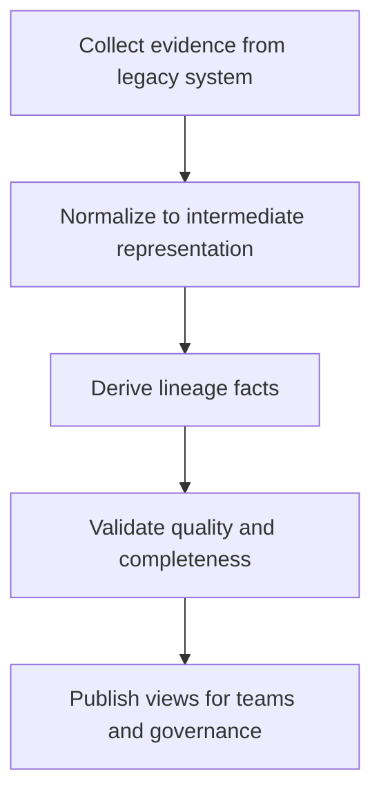

# Lineage Architecture Map

## Purpose

Show the pipeline and its implementation status. For the conceptual lifecycle, see [Derivation lifecycle](../core-concepts/derivation-lifecycle.md).

## Audience

Developers, business analysts, managers, and learners.

## Core idea

Do not maintain lineage by hand when system facts can be derived from code, configuration, and runtime signals.

## End-to-end flow

This is a conceptual view, not a claim that every source or provenance path is implemented.

## Use this section

- Need architecture detail: read [Universal Semantic Lineage Architecture](../Universal_Semantic_Lineage_Architecture.md).
- Need reconciliation detail: read [Continuous Architecture Reconciliation](../continuous-architecture-reconcilliation.md).
- Need lifecycle detail: read [Derivation lifecycle](../core-concepts/derivation-lifecycle.md).
- Need design rationale: read [Architecture Decision Records](../adr/index.md).

The diagram above is a simplified view. The implementation uses nine phases; see [ADR-0007](../adr/0007-explicit-pipeline-phases.md).

## Implementation status

- **Implemented:** the lineage plugin organizes processing into nine phases, including validation, merge, stitch and export. See [ADR-0007](../adr/0007-explicit-pipeline-phases.md) and [ADR-0012](../adr/0012-separate-canonical-knowledge-from-projections.md).
- **Partial:** source coverage varies and provenance is carried through merge but is incomplete after stitch.
- **Proposed:** end-to-end provenance. No PROV-O mapping is implemented. See [ADR-0011](../adr/0011-preserve-provenance.md).
- **Under construction:** examples are not yet fully runnable; see [example guidance](../how-to/build-first-lineage-slice.md).

## Related

- [Migration map](migration-map.md)
- [Evidence model](../core-concepts/evidence-model.md)
