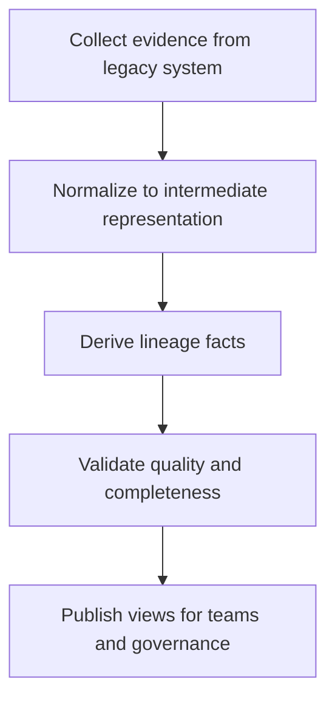

# Lineage Architecture Map

## Purpose

Show how Flowdigger derives lineage from real system evidence.

## Audience

Developers, business analysts, managers, and learners.

## Core idea

Do not maintain lineage by hand when system facts can be derived from code, configuration, and runtime signals.

## End-to-end flow

## Use this section

- Need architecture detail: read [Universal Semantic Lineage Architecture](../Universal_Semantic_Lineage_Architecture.md).
- Need reconciliation detail: read [Continuous Architecture Reconciliation](../continuous-architecture-reconcilliation.md).
- Need lifecycle detail: read [Derivation lifecycle](../core-concepts/derivation-lifecycle.md).

## Related

- [Migration map](migration-map.md)
- [Evidence model](../core-concepts/evidence-model.md)
