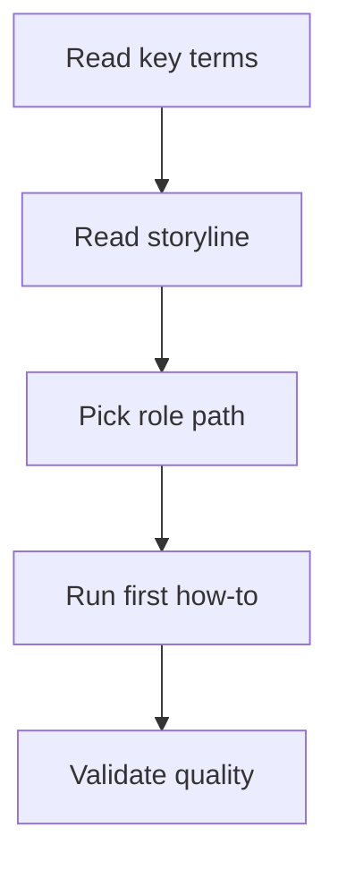

# Start Here

## Purpose

Give one simple path to first useful lineage result.

## Audience

All roles.

## What data lineage means

Data lineage shows where data comes from, how transformations change data, and where data goes next.

## Why this matters in legacy systems

Legacy systems hide logic in many places. Teams lose trust when lineage is stale or incomplete.

## Recommended path

1. Read [Data lineage in legacy systems](../core-concepts/data-lineage-basics.md).
2. Read [Storyline and learning path](../core-concepts/storyline.md).
3. Pick your [Role path](../role-paths/developer.md).
4. Execute [Build first lineage slice](../how-to/build-first-lineage-slice.md).

## Output

You know where to start and what to do next.

